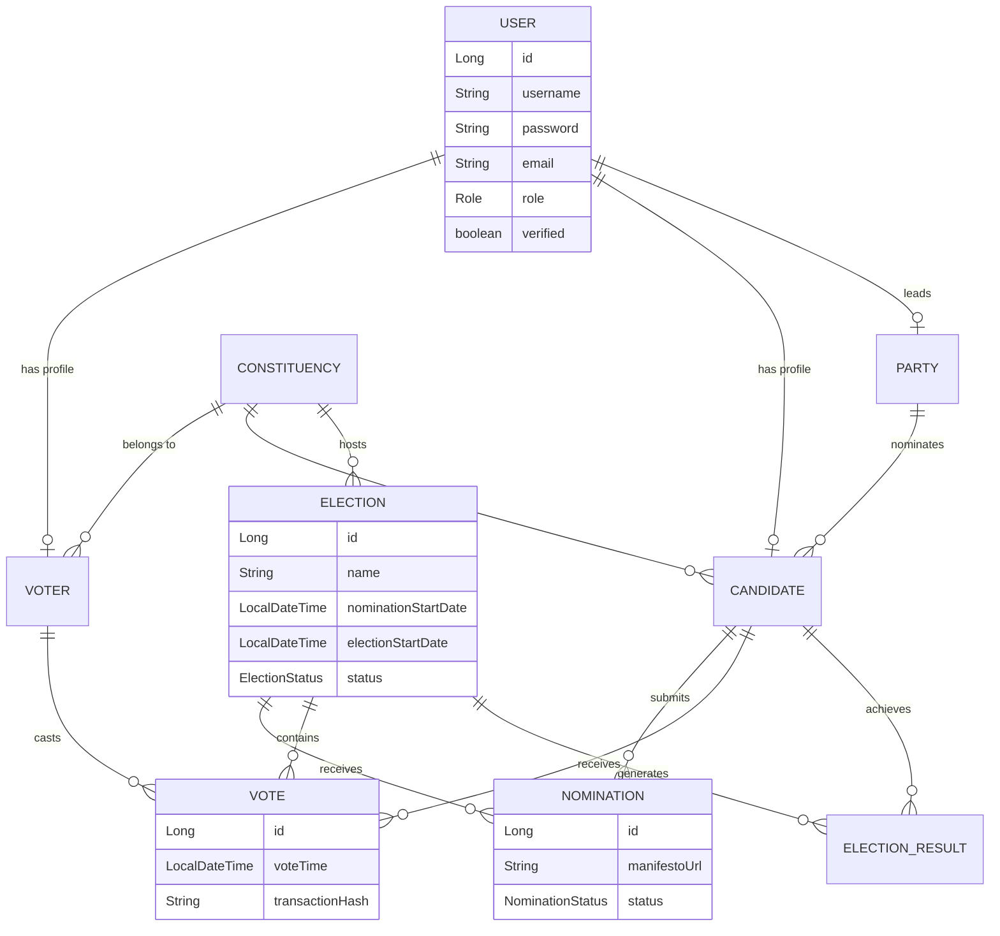

```mermaid
graph TD
    Client[📱 Client / Frontend] -->|HTTP Requests + Bearer Token| JwtFilter[🔒 JWT Authentication Filter]

    JwtFilter -->|Validates Token| Controllers

    subgraph Controllers [🌐 API Layer]
        AuthController[Auth Controller]
        ROController[Returning Officer Controller]
        PartyController[Party Controller]
        CandidateController[Candidate Controller]
        VoterController[Voter Controller]
    end

    Controllers -->|Business Logic| Services

    subgraph Services [⚙️ Service Layer]
        AuthService[Auth Service]
        ElectionService[Election Service]
        VotingService[Voting Service]
        ResultService[Result Service]
        NominationService[Nomination Service]
        PartyService[Party Service]
        VoterService[Voter Service]
        EmailService[Email Service]
    end

    Services -->|Data Access| Repositories

    subgraph Repositories [💾 Data Access Layer]
        UserRepo[User Repository]
        ElectionRepo[Election Repository]
        VoteRepo[Vote Repository]
        CandidateRepo[Candidate Repository]
        PartyRepo[Party Repository]
    end

    Repositories -->|JPA / Hibernate| DB[(🗄️ MySQL Database)]

    classDef filter fill:#f9d0c4,stroke:#333,stroke-width:2px;
    classDef controller fill:#d4e157,stroke:#333,stroke-width:2px;
    classDef service fill:#81d4fa,stroke:#333,stroke-width:2px;
    classDef repo fill:#ffcc80,stroke:#333,stroke-width:2px;
    classDef db fill:#b39ddb,stroke:#333,stroke-width:2px;

    class JwtFilter filter;
    class AuthController,ROController,PartyController,CandidateController,VoterController controller;
    class AuthService,ElectionService,VotingService,ResultService,NominationService,PartyService,VoterService,EmailService service;
    class UserRepo,ElectionRepo,VoteRepo,CandidateRepo,PartyRepo repo;
    class DB db;
```

# 🗳️ Election Management System (EMS) - Spring Boot at backend and React + Tyepscript + Tailwind CSS at frontend
---


A robust, scalable, and secure backend for an **Election Management System** built with Spring Boot. This system facilitates the entire election lifecycle, from voter registration and party creation to nomination processing, voting, and result computation.

---

## 📖 Table of Contents

* [System Architecture](https://www.google.com/search?q=%23-system-architecture)
* [Entity Relationship Diagram](https://www.google.com/search?q=%23-entity-relationship-diagram)
* [Features](https://www.google.com/search?q=%23-features)
* [Interactive API Documentation](https://www.google.com/search?q=%23-interactive-api-documentation)
* [Getting Started](https://www.google.com/search?q=%23-getting-started)
* [Environment Variables](https://www.google.com/search?q=%23-environment-variables)
* [Author](https://www.google.com/search?q=%23-author)

---

## 🏗️ System Architecture

The application follows a standard **Layered Architecture** using Spring Boot. It utilizes Spring Security with JWT for stateless authentication and JPA/Hibernate for database interactions.



---

## 🗄️ Entity Relationship Diagram



---

## ✨ Features

This system is divided into distinct roles, each with specific privileges.

* Self-registration with email verification.
* Secure login using JWT.
* View active elections based on assigned constituency.
* Cast a secure vote with strict double-voting prevention.
* View live and final election results.
* Update personal profile details.

* Register a new political party.
* Add and manage party candidates.
* View party-specific results and winning candidates.
* Update political party information.

* Submit nomination forms with manifesto and affidavit links.
* Track real-time nomination status (`Pending`, `Accepted`, `Rejected`).
* View election results.

* **Constituency Management:** Create, update, delete, and search constituencies.
* **Election Management:** Schedule elections, manage nomination phases, and control voting lifecycles.
* **Voter Management:** Monitor voter statistics and verify registrations.
* **Nomination Management:** Review, accept, or reject candidate nominations.
* **Results:** Trigger automated computation of election results and declare winners.
* **Party Management:** Review and approve registered political parties.

---

## 🛠️ Interactive API Documentation

> **Note:** All protected endpoints require `Authorization: Bearer <JWT_TOKEN>` in request headers.

| Method | Endpoint | Description |
| --- | --- | --- |
| `POST` | `/login` | Authenticate user credentials and return JWT token |
| `GET` | `/verify?token=...` | Verify account email address |
| `GET` | `/test-email-config` | Test mail server configuration |

### Constituencies

* `POST /constituencies` - Create a new constituency
* `GET /constituencies` - Retrieve all constituencies
* `PUT /constituencies/{id}/total-voters` - Update total voter count

### Elections

* `POST /elections` - Schedule a new election
* `PUT /elections/{id}/start-nomination` - Open nomination window
* `PUT /elections/{id}/end-election` - Conclude the election
* `POST /elections/{id}/compute-results` - Trigger final result calculation

### Nominations & Voters

* `GET /nominations/pending` - List all pending nominations
* `PUT /nominations/{id}/accept` - Approve candidate nomination
* `PUT /voters/{id}/verify` - Mark voter profile as verified

| Method | Endpoint | Description |
| --- | --- | --- |
| `POST` | `/register` | Register a new political party |
| `POST` | `/candidates` | Register a candidate under the party |
| `GET` | `/candidates` | List candidates associated with the party |
| `GET` | `/results` | Fetch election results for party candidates |

| Method | Endpoint | Description |
| --- | --- | --- |
| `POST` | `/nominate` | Submit nomination application |
| `GET` | `/nominations` | Retrieve status of submitted nominations |
| `GET` | `/results` | View election results |

| Method | Endpoint | Description |
| --- | --- | --- |
| `POST` | `/register` | Register new voter account |
| `POST` | `/cast-vote` | Cast ballot for an active election |
| `GET` | `/has-voted` | Check voting eligibility/status for an election |
| `GET` | `/profile` | Retrieve authenticated voter profile |

---

## 🚀 Getting Started

### Prerequisites

* **Java 17** or higher
* **Maven 3.8+**
* **MySQL Server 8.0+**

### Installation

1. **Clone the repository**
```bash
git clone https://github.com/SabarishMS123/election-management-system.git
cd election-management-system

```


2. **Database Setup**
Log in to MySQL and initialize the database:
```sql
CREATE DATABASE election_db;

```


3. **Configure `application.properties**`
Open `src/main/resources/application.properties` and update your settings:
```properties
spring.datasource.url=jdbc:mysql://localhost:3306/election_db?useSSL=false&serverTimezone=Asia/Kolkata&allowPublicKeyRetrieval=true
spring.datasource.username=YOUR_DB_USERNAME
spring.datasource.password=YOUR_DB_PASSWORD

# Email Configuration (for verification links)
spring.mail.username=YOUR_EMAIL@gmail.com
spring.mail.password=YOUR_APP_PASSWORD

```


4. **Build and Run**
```bash
mvn clean install
mvn spring-boot:run

```


The application will start on `http://localhost:9000`.

### Access Swagger UI

Open your browser and navigate to:

```text
http://localhost:9000/swagger-ui/index.html

```

---

## 🔒 Environment Variables

For production deployment, use environment variables rather than hardcoding sensitive credentials:

| Variable | Description |
| --- | --- |
| `SPRING_DATASOURCE_USERNAME` | MySQL database username |
| `SPRING_DATASOURCE_PASSWORD` | MySQL database password |
| `SPRING_MAIL_USERNAME` | SMTP / Gmail username |
| `SPRING_MAIL_PASSWORD` | SMTP / Gmail App-specific password |
| `JWT_SECRET` | Base64-encoded secret key for JWT |

---

## 👨‍💻 Author

**Sabarish M S**

Salem, Tamil Nadu, India

* GitHub: [@SabarishMS123](https://www.google.com/search?q=https://github.com/SabarishMS123)
* Portfolio: [sabarishdev.netlify.app](https://www.google.com/search?q=https://sabarishdev.netlify.app)

---

© All rights reserved.
