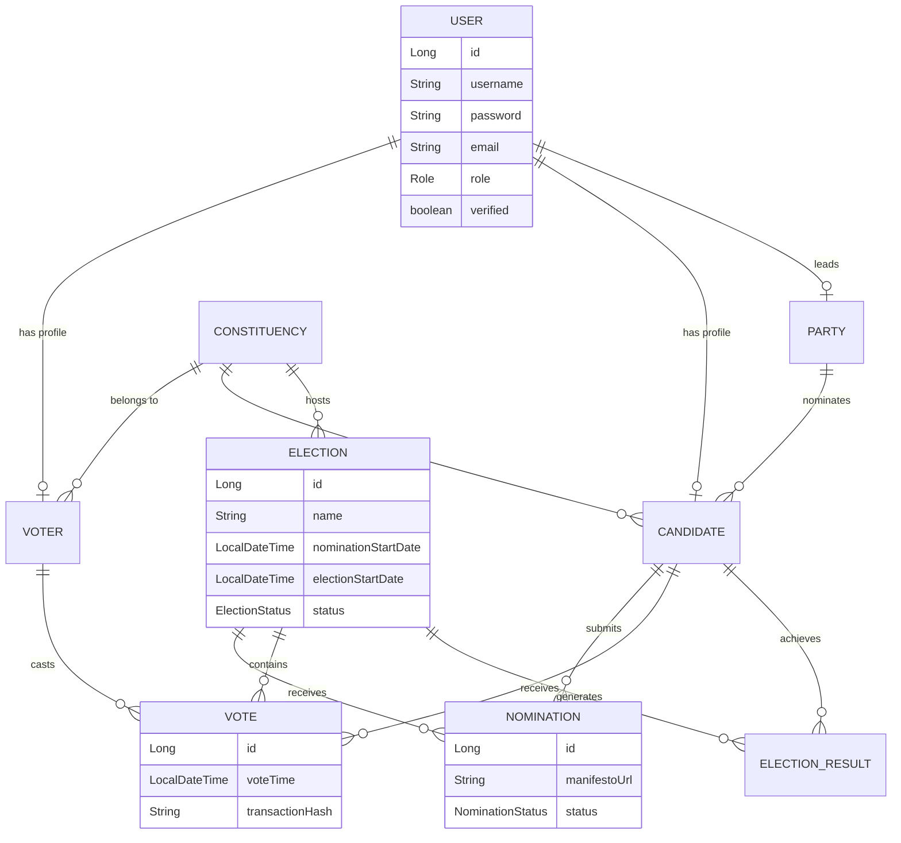

# 🗳️ Election Management System (EMS)

### Spring Boot • React • TypeScript • Tailwind CSS


A robust, scalable, and secure **Election Management System** built with **Spring Boot** on the backend and **React + TypeScript + Tailwind CSS** on the frontend. The platform facilitates the entire election lifecycle — from voter registration and party creation to nomination processing, secure voting, and automated result computation.

---

## 📖 Table of Contents

- [System Architecture](#-system-architecture)
- [Entity Relationship Diagram](#-entity-relationship-diagram)
- [Tech Stack](#-tech-stack)
- [Features](#-features)
- [API Documentation](#-api-documentation)
- [Getting Started](#-getting-started)
- [Environment Variables](#-environment-variables)
- [Project Structure](#-project-structure)
- [Roadmap](#-roadmap)
- [Contributing](#-contributing)
- [License](#-license)
- [Author](#-author)

---

## 🏗️ System Architecture

The backend follows a standard **Layered Architecture** using Spring Boot. It uses **Spring Security with JWT** for stateless authentication and **JPA / Hibernate** for database interactions.

```mermaid
graph TD
    Client[📱 Client / Frontend] -->|HTTP Requests + Bearer Token| JwtFilter[🔒 JWT Authentication Filter]

    JwtFilter -->|Validates Token| Controllers

    subgraph Controllers [🌐 API Layer]
        AuthController[Auth Controller]
        ROController[Returning Officer Controller]
        PartyController[Party Controller]
        CandidateController[Candidate Controller]
        VoterController[Voter Controller]
    end

    Controllers -->|Business Logic| Services

    subgraph Services [⚙️ Service Layer]
        AuthService[Auth Service]
        ElectionService[Election Service]
        VotingService[Voting Service]
        ResultService[Result Service]
        NominationService[Nomination Service]
        PartyService[Party Service]
        VoterService[Voter Service]
        EmailService[Email Service]
    end

    Services -->|Data Access| Repositories

    subgraph Repositories [💾 Data Access Layer]
        UserRepo[User Repository]
        ElectionRepo[Election Repository]
        VoteRepo[Vote Repository]
        CandidateRepo[Candidate Repository]
        PartyRepo[Party Repository]
    end

    Repositories -->|JPA / Hibernate| DB[(🗄️ MySQL Database)]

    classDef filter fill:#f9d0c4,stroke:#333,stroke-width:2px;
    classDef controller fill:#d4e157,stroke:#333,stroke-width:2px;
    classDef service fill:#81d4fa,stroke:#333,stroke-width:2px;
    classDef repo fill:#ffcc80,stroke:#333,stroke-width:2px;
    classDef db fill:#b39ddb,stroke:#333,stroke-width:2px;

    class JwtFilter filter;
    class AuthController,ROController,PartyController,CandidateController,VoterController controller;
    class AuthService,ElectionService,VotingService,ResultService,NominationService,PartyService,VoterService,EmailService service;
    class UserRepo,ElectionRepo,VoteRepo,CandidateRepo,PartyRepo repo;
    class DB db;
```



---

## 🗄️ Entity Relationship Diagram



---

## 🛠️ Tech Stack

| Layer | Technology |
| --- | --- |
| **Language** | Java 17 |
| **Backend Framework** | Spring Boot 3.1.5 |
| **Security** | Spring Security + JWT (stateless) |
| **Persistence** | Spring Data JPA / Hibernate |
| **Database** | MySQL 8.0 |
| **API Docs** | Swagger / OpenAPI 3 |
| **Email** | Spring Mail (SMTP) |
| **Frontend** | React + TypeScript |
| **Styling** | Tailwind CSS |
| **Build Tool** | Maven |

---

## ✨ Features

The system is divided into distinct roles, each with dedicated privileges.

### 👤 Voter

- Self-registration with email verification.
- Secure login using JWT.
- View active elections based on assigned constituency.
- Cast a secure vote with strict double-voting prevention.
- View live and final election results.
- Update personal profile details.

### 🏛️ Political Party

- Register a new political party.
- Add and manage party candidates.
- View party-specific results and winning candidates.
- Update political party information.

### 📝 Candidate

- Submit nomination forms with manifesto and affidavit links.
- Track real-time nomination status (`Pending`, `Accepted`, `Rejected`).
- View election results.

### 🧑‍⚖️ Returning Officer (Admin)

- **Constituency Management:** Create, update, delete, and search constituencies.
- **Election Management:** Schedule elections, manage nomination phases, and control voting lifecycles.
- **Voter Management:** Monitor voter statistics and verify registrations.
- **Nomination Management:** Review, accept, or reject candidate nominations.
- **Results:** Trigger automated computation of election results and declare winners.
- **Party Management:** Review and approve registered political parties.

### 🔐 Security Highlights

- Stateless JWT-based authentication.
- Role-based access control (RBAC).
- Email verification for account activation.
- Double-voting prevention at the service layer.
- Every vote is timestamped and assigned a transaction hash for auditability.

---

## 📡 API Documentation

> **Note:** All protected endpoints require `Authorization: Bearer <JWT_TOKEN>` in the request headers.
> Some paths (e.g., `/register`, `/results`) are **role-scoped** — access rules and response payloads depend on the authenticated user's role.

### 🔓 Authentication & Public

| Method | Endpoint | Description | Auth Required |
| --- | --- | --- | :---: |
| `POST` | `/register` | Register a new user (role-scoped) | ❌ |
| `POST` | `/login` | Authenticate credentials and return JWT | ❌ |
| `GET` | `/verify?token=...` | Verify account email address | ❌ |
| `GET` | `/test-email-config` | Test mail server configuration | ✅ |

**Example — Login**
```http
POST /login
Content-Type: application/json

{
  "username": "john_doe",
  "password": "Secret@123"
}
```

```json
{
  "token": "eyJhbGciOiJIUzI1NiIsInR5cCI6IkpXVCJ9...",
  "role": "VOTER",
  "verified": true
}
```

---

### 👤 Voter Endpoints

| Method | Endpoint | Description |
| --- | --- | --- |
| `POST` | `/register` | Register a new voter account |
| `POST` | `/cast-vote` | Cast a ballot for an active election |
| `GET` | `/has-voted` | Check voting eligibility/status for an election |
| `GET` | `/profile` | Retrieve the authenticated voter profile |

**Example — Cast a Vote**
```http
POST /cast-vote
Authorization: Bearer <JWT_TOKEN>
Content-Type: application/json

{
  "electionId": 12,
  "candidateId": 45
}
```

---

### 🏛️ Party Endpoints

| Method | Endpoint | Description |
| --- | --- | --- |
| `POST` | `/register` | Register a new political party |
| `POST` | `/candidates` | Register a candidate under the party |
| `GET` | `/candidates` | List candidates associated with the party |
| `GET` | `/results` | Fetch election results for party candidates |

---

### 📝 Candidate Endpoints

| Method | Endpoint | Description |
| --- | --- | --- |
| `POST` | `/nominate` | Submit a nomination application |
| `GET` | `/nominations` | Retrieve status of submitted nominations |
| `GET` | `/results` | View election results |

---

### 🧑‍⚖️ Returning Officer Endpoints

| Method | Endpoint | Description |
| --- | --- | --- |
| `POST` | `/constituencies` | Create a new constituency |
| `GET` | `/constituencies` | Retrieve all constituencies |
| `PUT` | `/constituencies/{id}/total-voters` | Update total voter count |
| `POST` | `/elections` | Schedule a new election |
| `PUT` | `/elections/{id}/start-nomination` | Open the nomination window |
| `PUT` | `/elections/{id}/end-election` | Conclude the election |
| `POST` | `/elections/{id}/compute-results` | Trigger final result calculation |
| `GET` | `/nominations/pending` | List all pending nominations |
| `PUT` | `/nominations/{id}/accept` | Approve a candidate nomination |
| `PUT` | `/voters/{id}/verify` | Mark a voter profile as verified |

---

## 🚀 Getting Started

### Prerequisites

- **Java 17** or higher
- **Maven 3.8+**
- **MySQL Server 8.0+**
- **Node.js 18+** (for the frontend)

### Installation

**1. Clone the repository**

```bash
git clone https://github.com/SabarishMS123/election-management-system.git
cd election-management-system
```

**2. Database Setup**

Log in to MySQL and initialize the database:

```sql
CREATE DATABASE election_db;
```

**3. Configure `application.properties`**

Open `src/main/resources/application.properties` and update the settings:

```properties
spring.datasource.url=jdbc:mysql://localhost:3306/election_db?useSSL=false&serverTimezone=Asia/Kolkata&allowPublicKeyRetrieval=true
spring.datasource.username=YOUR_DB_USERNAME
spring.datasource.password=YOUR_DB_PASSWORD

# Email Configuration (for verification links)
spring.mail.username=YOUR_EMAIL@gmail.com
spring.mail.password=YOUR_APP_PASSWORD
```

**4. Build and Run**

```bash
mvn clean install
mvn spring-boot:run
```

The backend will start on **`http://localhost:9000`**.

### Access Swagger UI

Open your browser and navigate to:

```
http://localhost:9000/swagger-ui/index.html
```

---

## 🔒 Environment Variables

For production deployment, use environment variables rather than hardcoding sensitive credentials.

| Variable | Description |
| --- | --- |
| `SPRING_DATASOURCE_USERNAME` | MySQL database username |
| `SPRING_DATASOURCE_PASSWORD` | MySQL database password |
| `SPRING_MAIL_USERNAME` | SMTP / Gmail username |
| `SPRING_MAIL_PASSWORD` | SMTP / Gmail app-specific password |
| `JWT_SECRET` | Base64-encoded secret key for JWT signing |

---

## 📁 Project Structure

```
election-management-system/
├── src/
│   ├── main/
│   │   ├── java/com/sabarish/ems/
│   │   │   ├── config/          # Security, Swagger, CORS configuration
│   │   │   ├── controller/      # REST API controllers
│   │   │   ├── dto/             # Request / Response DTOs
│   │   │   ├── entity/          # JPA entities
│   │   │   ├── exception/       # Global exception handling
│   │   │   ├── repository/      # Spring Data JPA repositories
│   │   │   ├── security/        # JWT filter, provider, utils
│   │   │   ├── service/         # Business logic
│   │   │   └── EmsApplication.java
│   │   └── resources/
│   │       ├── application.properties
│   │       └── ...
│   └── test/
├── pom.xml
└── README.md
```

> 📌 Structure is indicative — package layout may vary.

---

## 🗺️ Roadmap

- [ ] Add OTP-based two-factor authentication for voters.
- [ ] Integrate a blockchain-based audit trail for votes.
- [ ] Add a real-time analytics dashboard for Returning Officers.
- [ ] Support multi-language (i18n) for the frontend.
- [ ] Containerize the backend with Docker + Docker Compose.
- [ ] Add unit and integration test coverage (JUnit 5 + Mockito).

---

## 🤝 Contributing

Contributions, issues, and feature requests are welcome!

1. Fork the repository.
2. Create your feature branch: `git checkout -b feature/amazing-feature`.
3. Commit your changes: `git commit -m "Add some amazing feature"`.
4. Push to the branch: `git push origin feature/amazing-feature`.
5. Open a Pull Request.

Please make sure to update tests as appropriate.

---

## 📄 License

**© All Rights Reserved.**

This project and its source code are the intellectual property of the author. Unauthorized copying, modification, or distribution of this project, via any medium, is strictly prohibited without prior written permission.

---

## 👨‍💻 Author

**Sabarish M S**

📍 Salem, Tamil Nadu, India

- GitHub: [@SabarishMS123](https://github.com/SabarishMS123)
- Portfolio: [sabarishdev.netlify.app](https://sabarishdev.netlify.app)

---

## 🙏 Acknowledgements

- [Spring Boot](https://spring.io/projects/spring-boot)
- [Spring Security](https://spring.io/projects/spring-security)
- [React](https://reactjs.org/)
- [Tailwind CSS](https://tailwindcss.com/)
- [Swagger / OpenAPI](https://swagger.io/)

---

⭐ If you found this project helpful, consider giving it a star!
